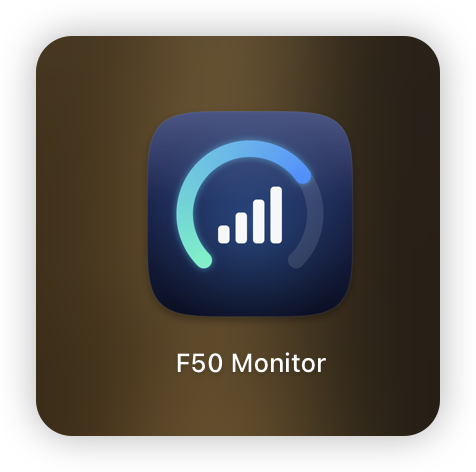
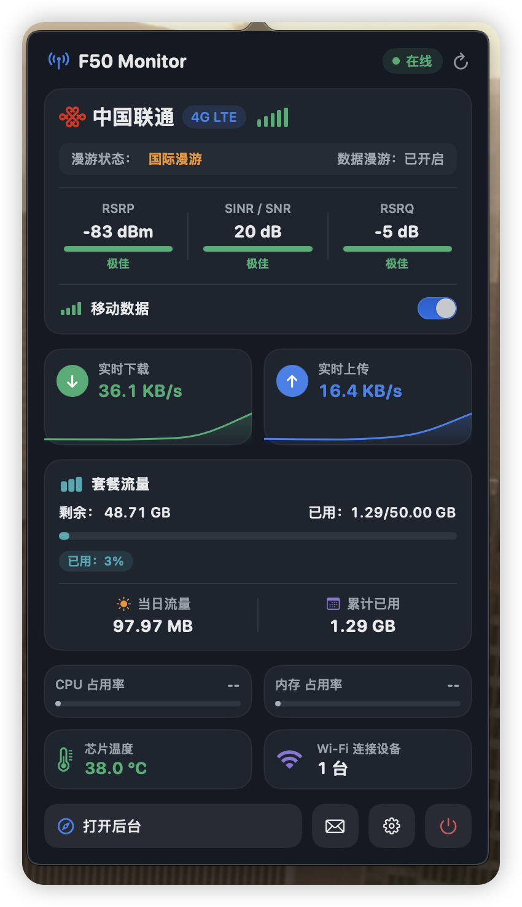

# F50 PRO Monitor

<p align="center">
  
</p>

中兴 **F50 Pro** 5G 随身 WiFi 的 macOS 菜单栏监控工具。
在菜单栏直接看当日用量，点开面板查看信号、漫游状态、套餐流量，并可一键开关移动数据。

> 基于 [koldllc/f50-monitor](https://github.com/koldllc/f50-monitor)（MIT）精简改造：只保留 macOS 端，只依赖路由器自带后台（80 端口），
> 无需刷机、无需安装 UFI 工具箱。针对 F50 Pro 固件 `B22`（MU3356）实测适配。

## 截图

<p align="center">
  
</p>

## 功能

- **菜单栏常驻**：默认显示当日已用流量；可在设置中切换为实时速率、套餐用量、温度、Wi-Fi 设备数或仅图标
- **网络与信号**：运营商、网络制式（5G SA / NSA / 4G LTE）、频段、信号格，RSRP / SINR / RSRQ 及质量评级
- **漫游状态**：未漫游 / 国内漫游 / 国际漫游，以及路由器上数据漫游开关的状态
- **移动数据开关**：在面板上直接断开 / 连接蜂窝数据
- **网络模式快捷切换**：面板提供「仅 4G / 自动 5G」，「更多」中可选 5G SA、5G NSA；复用原厂后台，无需 root。选中状态以设备回读配置为准
- **套餐流量**：读取路由器后台设置的套餐总量，显示已用、剩余、进度条；
  固定流量包（路由器「自动清零」关闭）不会显示误导性的「N 天后重置」
- **当日流量 / 累计已用**：固件没有当日计数器，应用以本地基线计算当日用量；Mac 跨零点睡眠也不会漏算夜间用量
- **实时速率**：上下行速率与迷你曲线
- **硬件状态**：芯片温度、Wi-Fi 连接设备数；开启设备 ADB 后可额外显示 CPU / 内存占用率
- **短信**：查看、发送短信，未读角标与系统通知
- **其他**：登录时自动启动、一键打开路由器后台

## 系统要求

- macOS 13 Ventura 及以上，**Apple 芯片（arm64）**
- Mac 与 F50 Pro 处于同一网络（默认地址 `192.168.0.1`）

## 安装

### 方式一：下载 dmg

在 [Releases](https://github.com/cjbbb/F50PRO-monitor/releases) 下载 `F50-Monitor-x.y.z-arm64.dmg`，打开后把 **F50 Monitor** 拖入「应用程序」。

应用未经 Apple 公证，首次打开会被 Gatekeeper 拦截，任选其一：

- 「系统设置 → 隐私与安全性」中点击 **仍要打开**
- 或在终端执行：

  ```bash
  xattr -dr com.apple.quarantine "/Applications/F50 Monitor.app"
  ```

### 方式二：从源码构建

需要 Xcode 命令行工具（`xcode-select --install`）。

```bash
git clone git@github.com:cjbbb/F50PRO-monitor.git
cd F50PRO-monitor

./build.sh          # 编译 release、打包、安装到 /Applications 并启动
./build.sh --dmg    # 只打包为 dist/F50-Monitor-<版本>-arm64.dmg，不安装
swift test          # 运行单元测试（需要带 XCTest 的完整 Xcode）
```

## 使用

1. 首次启动时填写设备地址（默认 `192.168.0.1`）和路由器管理密码；设备地址可在设置中修改。
2. 点击菜单栏图标打开面板；底部按钮依次为：打开后台、短信、设置、退出。
3. 登录密码保存在本机钥匙串（Keychain）；后续切换网络模式、开关移动数据和发送短信时会自动登录，无需重复输入。

> ⚠️ 如果这台 Mac 本身就通过 F50 Pro 上网，关闭「移动数据」后 Mac 会断网——路由器局域网仍然可达，在面板上重新打开即可。

### 设置项

| 设置 | 说明 |
| --- | --- |
| 登录时自动启动 | 开机后自动常驻菜单栏 |
| 设备 IP / 域名 | 路由器地址，支持内网穿透后的域名 |
| 中兴后台口令 | 路由器管理密码 |
| 自动刷新频率 | 状态轮询间隔（1 / 3 / 5 / 10 秒）；流量数据固定每 30 秒更新 |
| 菜单栏显示模式 | 当日用量 / 速率 / 套餐用量 / CPU 内存 / 温度 / Wi-Fi 设备数 / 仅图标 |

### 关于 CPU / 内存占用率

F50 Pro 的网页后台不提供这两项指标，面板默认显示 `--`。
按 [ADB 指南](docs/ADB_AND_FLASHING_GUIDE.md) 开启设备的 ADB 调试（5555 端口）后，应用会自动通过 ADB 读取并显示，无需额外配置。

## 适配说明（F50 Pro · 固件 B22 / B28）

原有监控和移动数据开关针对 B22 实测；网络模式接口与参数来自 B28 原厂后台脚本，尚未完成真机切换验证。

| 项目 | 说明 |
| --- | --- |
| 只读接口 | `GET /goform/goform_get_cmd_process`，携带 `Referer` 即可匿名读取 |
| 登录 | `LD` 挑战值 + `SHA256(SHA256(密码) + LD)`。固件的 SHA256 输出**大写**十六进制，内层摘要必须以大写参与拼接 |
| 写操作鉴权 | 需携带 `AD = SHA256(SHA256(wa_inner_version + cr_version) + RD)`，大小写规则同上 |
| 登录锁定 | 连续 5 次登录失败会锁定账户 300 秒（`psw_fail_num_str` 为剩余次数，`login_lock_time` 为剩余秒数）。应用在口令被拒后不再重试，且剩余次数 < 3 或已锁定时不尝试登录 |
| 移动数据开关 | `goformId=CONNECT_NETWORK` / `DISCONNECT_NETWORK`，状态取自 `ppp_status` |
| 网络模式（B28 后台脚本确认） | `goformId=SET_BEARER_PREFERENCE`，`BearerPreference`：`Only_LTE`（仅 4G）、`WL_AND_5G`（自动 5G/4G/3G）、`Only_5G`（5G SA）、`LTE_AND_5G`（5G NSA）；回读 `network_net_select`。需管理员登录与 AD，无需 root；切换可能短暂断网，自动模式允许回落 4G/3G |
| 套餐总量 | 键名带 `flux_` 前缀：`flux_data_volume_limit_size`（如 `50_1024` = 50 GB） |
| 清零日 | `flux_clear_date`；仅当 `flux_auto_clear_flow_data_switch` 不为 `off` 时才视为有效 |
| 漫游 | `network_simcard_roam`：`Home` / `Internal` / `International`；开关为 `roam_setting_option` |
| 温度 | `cpu_temperature`（其余温度键在该固件上返回空串） |
| 当日用量 | 固件无当日计数器，用累计值（`monthly_rx/tx_bytes`）减本地记录的当日基线 |

其他中兴 F50 / V50 / U30 Air 等同系设备理论上可用，但未逐一验证。遇到「无数据」时，可对照路由器后台的 `js/service.js` 核对实际键名。

## 与上游的差异

**新增**：移动数据开关、漫游状态、菜单栏当日用量、固定流量包适配、`flux_` 键与 `cpu_temperature` 适配、全新应用图标、dmg 打包。

**移除**：Windows / iOS 端、UFI 工具箱（2333 端口）通道、诊断反馈、自动更新、无线投屏、文件共享、QCI / 签约速率。

**重构**：抓取主流程由嵌套回调改为 async/await；Swift 代码约 11000 行精简至约 4300 行。

## 项目结构

```
Sources/F50Core/       网络抓取、响应解析、状态模型、钥匙串、短信通知（可独立单测）
Sources/F50Monitor/    macOS 菜单栏应用（SwiftUI + AppKit）
Tests/                 单元测试
scripts/make_icon.sh   应用图标生成脚本（CoreGraphics 绘制，A / B / C 三种方案）
build.sh               编译、打包、安装 / 生成 dmg
```

## 免责声明

本项目为个人自用工具，与中兴通讯无关。应用仅访问你自己局域网内的路由器后台接口；使用移动数据开关、发送短信等功能产生的后果由使用者自行承担。

## 致谢与许可证

- 原项目：[koldllc/f50-monitor](https://github.com/koldllc/f50-monitor) © Kelvin Sze
- 本项目沿用 [MIT License](LICENSE)
